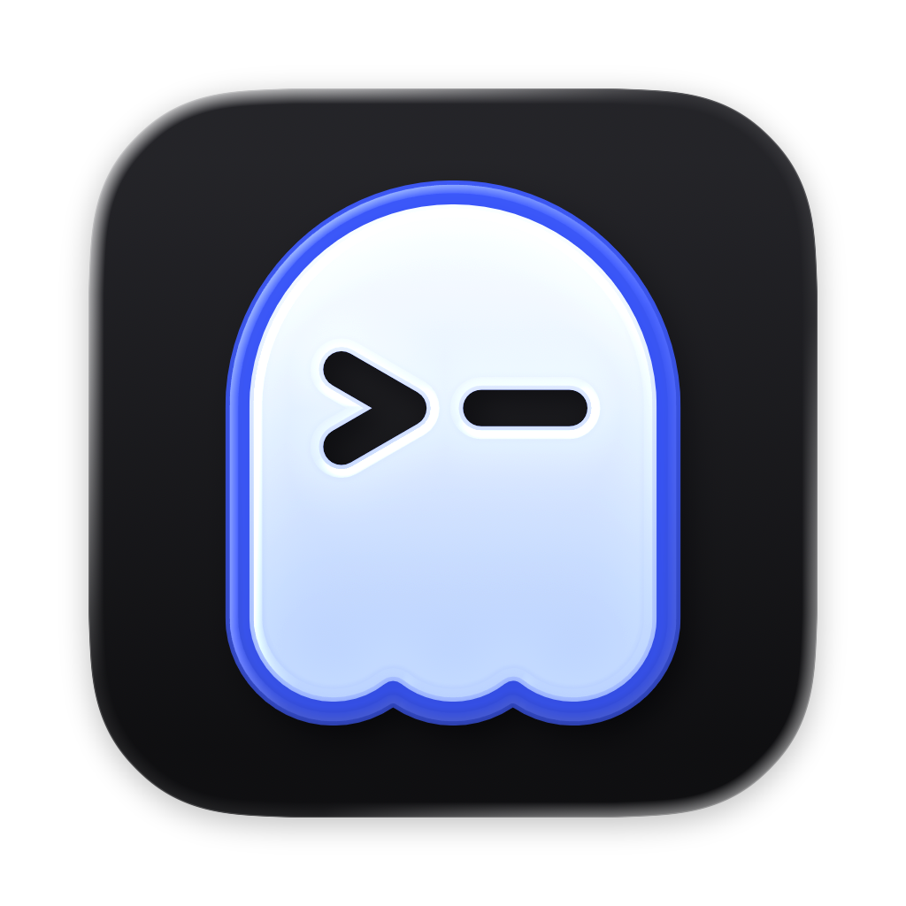
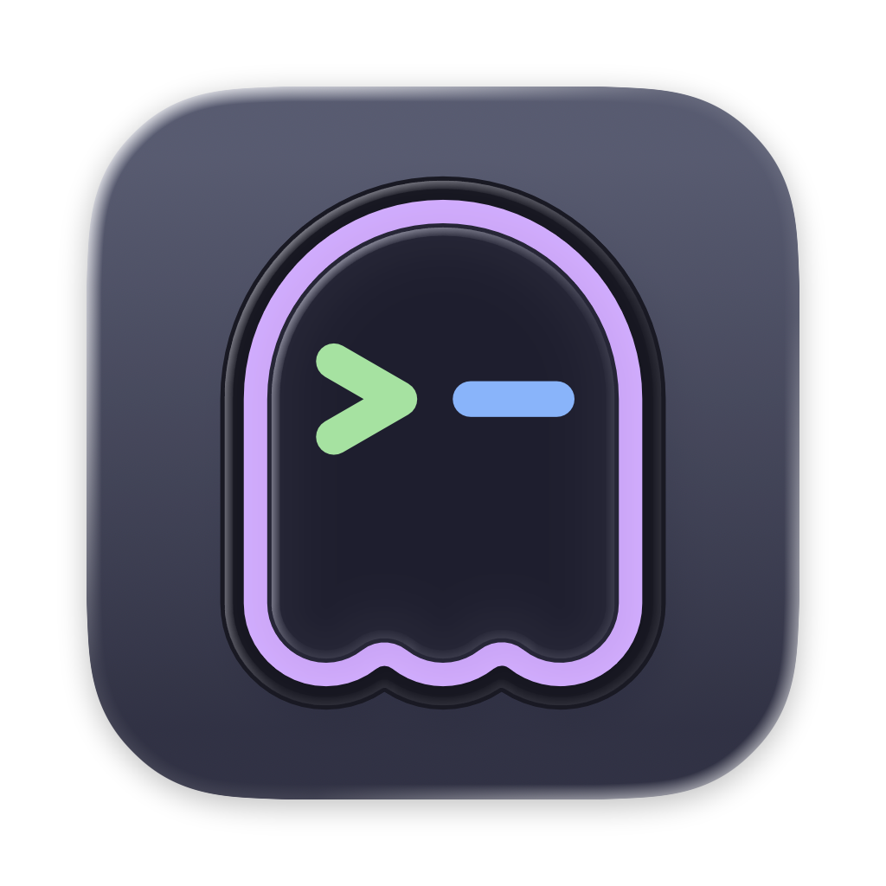
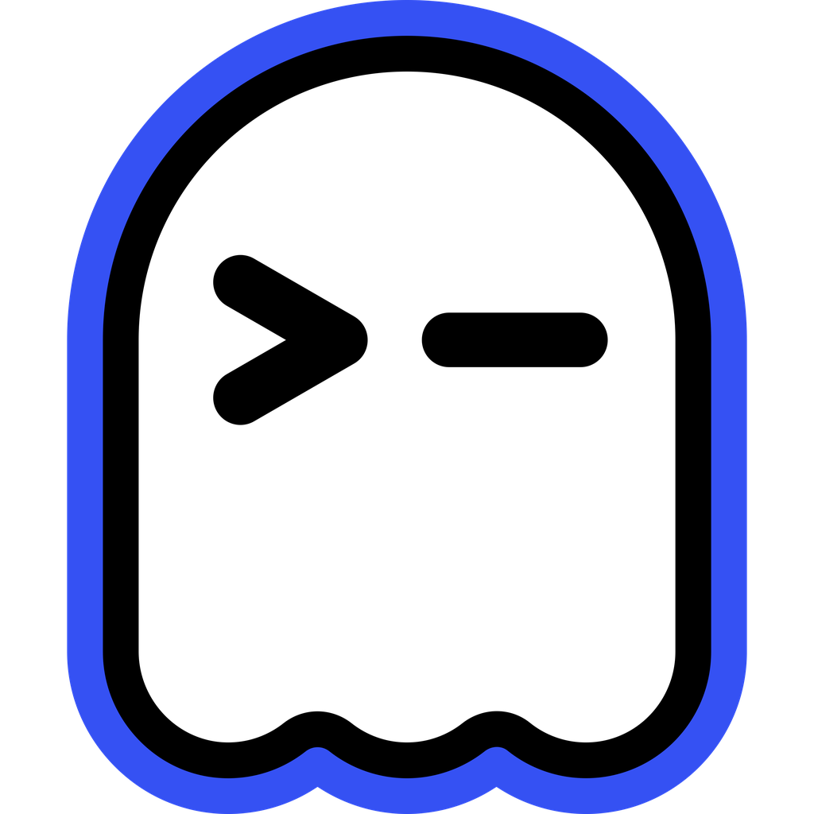
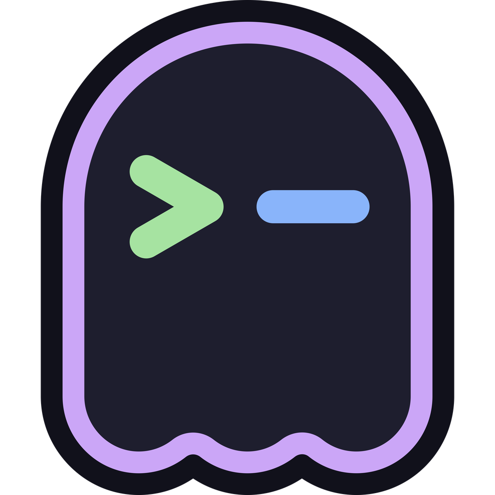
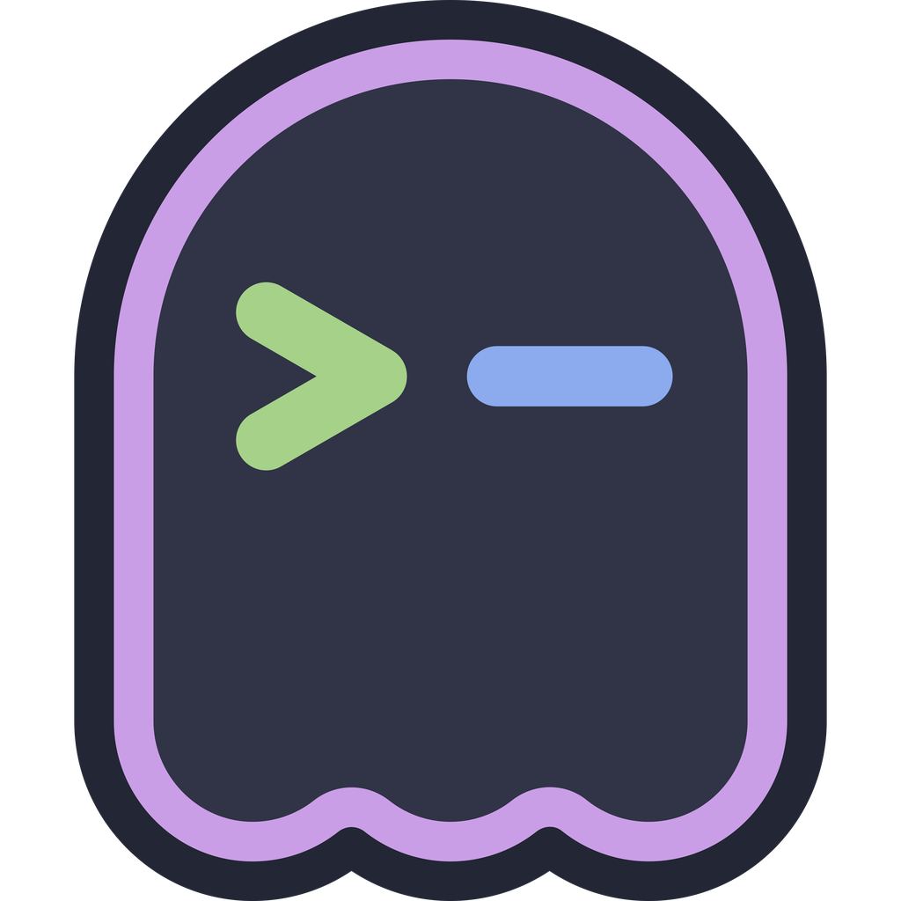
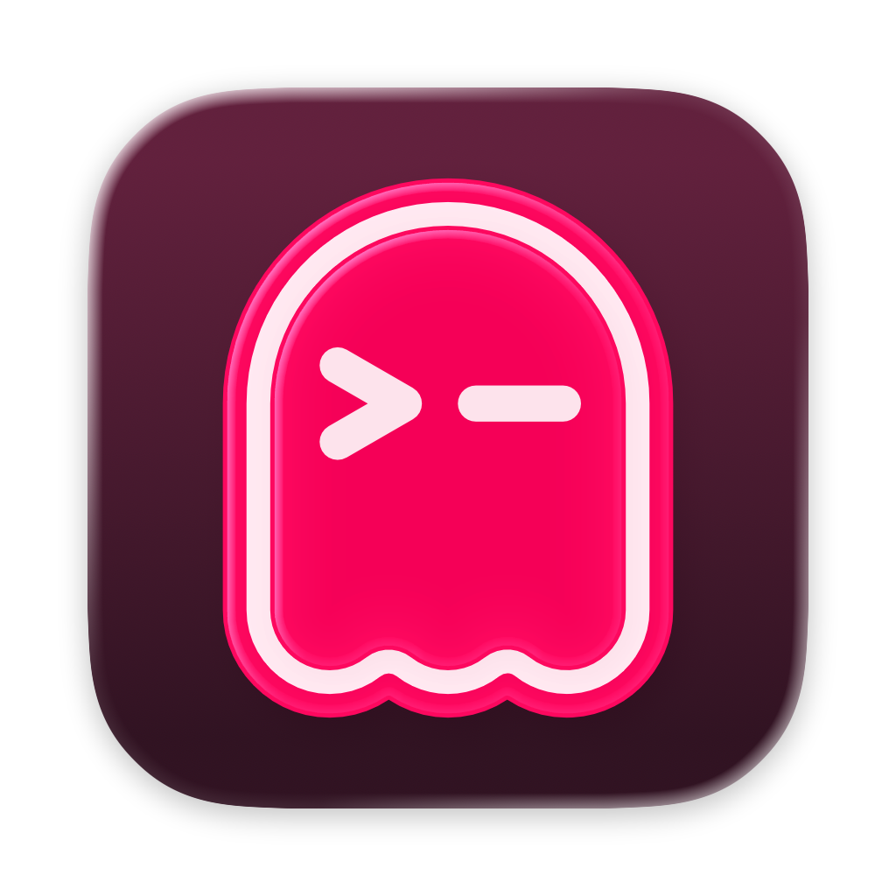

# Ghostty App Icons

<p align="center">
  <a href="https://raw.githubusercontent.com/lukejanicke/ghostty-app-icons/refs/heads/main/icons/tile/ghostty-tile-graphite-original.icns"></a>
  <a href="https://raw.githubusercontent.com/lukejanicke/ghostty-app-icons/refs/heads/main/icons/tile/ghostty-tile-catppuccin-latte.icns"></a>
  <a href="https://raw.githubusercontent.com/lukejanicke/ghostty-app-icons/refs/heads/main/icons/tile/ghostty-tile-catppuccin-mocha.icns"></a>
</p>

Unofficial macOS app icons based on the [Ghostty logo](https://ghostty.org/ghostty-logo.svg).

## Installation

1. Download an `.icns` file and copy it to `~/.config/ghostty/icons/`. This example uses Graphite Original.

   ```sh
   mkdir -p ~/.config/ghostty/icons
   cp ~/Downloads/ghostty-tile-graphite-original.icns ~/.config/ghostty/icons/
   ```

2. Edit your Ghostty config file (typically `~/.config/ghostty/config.ghostty`) to select the installed icon.

   ```ini
   macos-icon = custom
   macos-custom-icon = ~/.config/ghostty/icons/ghostty-tile-graphite-original.icns
   ```

3. Reload Ghostty’s configuration.

Ghostty 1.4 supports custom icons in the Dock, app switcher, and Finder. Finder may need a view refresh to show the new icon. See [Ghostty icon settings](https://ghostty.org/docs/config/reference#macos-custom-icon) and [Ghostty 1.4 release notes](https://ghostty.org/docs/install/release-notes/1-4-0).

### Switch icons with light and dark mode

Install (for example) the Tile **Catppuccin Latte** and **Catppuccin Mocha** icons in `~/.config/ghostty/icons/`. Make local copies of the bundled [Catppuccin Latte theme](https://github.com/mbadolato/iTerm2-Color-Schemes/blob/master/ghostty/Catppuccin%20Latte) and [Catppuccin Mocha theme](https://github.com/mbadolato/iTerm2-Color-Schemes/blob/master/ghostty/Catppuccin%20Mocha).

```sh
mkdir -p ~/.config/ghostty/themes
cp -n "/Applications/Ghostty.app/Contents/Resources/ghostty/themes/Catppuccin Latte" ~/.config/ghostty/themes/"Catppuccin Latte with Icon"
cp -n "/Applications/Ghostty.app/Contents/Resources/ghostty/themes/Catppuccin Mocha" ~/.config/ghostty/themes/"Catppuccin Mocha with Icon"
```

Add the corresponding icon setting to each local theme file.

In `~/.config/ghostty/themes/Catppuccin Latte with Icon` add:
```
macos-custom-icon = ~/.config/ghostty/icons/ghostty-tile-catppuccin-latte.icns
```

In `~/.config/ghostty/themes/Catppuccin Mocha with Icon` add:
```
macos-custom-icon = ~/.config/ghostty/icons/ghostty-tile-catppuccin-mocha.icns
```

In `~/.config/ghostty/config.ghostty`, select the two themes and remove or comment out any global `macos-custom-icon` setting, which takes precedence over the theme files.

```ini
macos-icon = custom
theme = light:Catppuccin Latte with Icon,dark:Catppuccin Mocha with Icon
```

Reload Ghostty to apply the changes. See [Ghostty light and dark themes](https://ghostty.org/docs/features/theme#separate-light-and-dark-themes).

## Downloads

| Theme | Cutout | Tile |
| --- | :---: | :---: |
| Original | <a href="https://raw.githubusercontent.com/lukejanicke/ghostty-app-icons/refs/heads/main/icons/cutout/ghostty-cutout-original.icns"></a> | <a href="https://raw.githubusercontent.com/lukejanicke/ghostty-app-icons/refs/heads/main/icons/tile/ghostty-tile-graphite-original.icns"></a> |
| Black | <a href="https://raw.githubusercontent.com/lukejanicke/ghostty-app-icons/refs/heads/main/icons/cutout/ghostty-cutout-black.icns"></a> | <a href="https://raw.githubusercontent.com/lukejanicke/ghostty-app-icons/refs/heads/main/icons/tile/ghostty-tile-black.icns"></a> |
| White | <a href="https://raw.githubusercontent.com/lukejanicke/ghostty-app-icons/refs/heads/main/icons/cutout/ghostty-cutout-white.icns"></a> | <a href="https://raw.githubusercontent.com/lukejanicke/ghostty-app-icons/refs/heads/main/icons/tile/ghostty-tile-white.icns"></a> |
| Catppuccin Mocha | <a href="https://raw.githubusercontent.com/lukejanicke/ghostty-app-icons/refs/heads/main/icons/cutout/ghostty-cutout-catppuccin-mocha.icns"></a> | <a href="https://raw.githubusercontent.com/lukejanicke/ghostty-app-icons/refs/heads/main/icons/tile/ghostty-tile-catppuccin-mocha.icns"></a> |
| Catppuccin Macchiato | <a href="https://raw.githubusercontent.com/lukejanicke/ghostty-app-icons/refs/heads/main/icons/cutout/ghostty-cutout-catppuccin-macchiato.icns"></a> | <a href="https://raw.githubusercontent.com/lukejanicke/ghostty-app-icons/refs/heads/main/icons/tile/ghostty-tile-catppuccin-macchiato.icns"></a> |
| Catppuccin Frappé | <a href="https://raw.githubusercontent.com/lukejanicke/ghostty-app-icons/refs/heads/main/icons/cutout/ghostty-cutout-catppuccin-frappe.icns"></a> | <a href="https://raw.githubusercontent.com/lukejanicke/ghostty-app-icons/refs/heads/main/icons/tile/ghostty-tile-catppuccin-frappe.icns"></a> |
| Catppuccin Latte | <a href="https://raw.githubusercontent.com/lukejanicke/ghostty-app-icons/refs/heads/main/icons/cutout/ghostty-cutout-catppuccin-latte.icns"></a> | <a href="https://raw.githubusercontent.com/lukejanicke/ghostty-app-icons/refs/heads/main/icons/tile/ghostty-tile-catppuccin-latte.icns"></a> |
| Café Espresso | <a href="https://raw.githubusercontent.com/lukejanicke/ghostty-app-icons/refs/heads/main/icons/cutout/ghostty-cutout-cafe-espresso.icns"></a> | <a href="https://raw.githubusercontent.com/lukejanicke/ghostty-app-icons/refs/heads/main/icons/tile/ghostty-tile-cafe-espresso.icns"></a> |
| Café Latte | <a href="https://raw.githubusercontent.com/lukejanicke/ghostty-app-icons/refs/heads/main/icons/cutout/ghostty-cutout-cafe-latte.icns"></a> | <a href="https://raw.githubusercontent.com/lukejanicke/ghostty-app-icons/refs/heads/main/icons/tile/ghostty-tile-cafe-latte.icns"></a> |
| Material Dark | <a href="https://raw.githubusercontent.com/lukejanicke/ghostty-app-icons/refs/heads/main/icons/cutout/ghostty-cutout-material-dark.icns"></a> | <a href="https://raw.githubusercontent.com/lukejanicke/ghostty-app-icons/refs/heads/main/icons/tile/ghostty-tile-material-dark.icns"></a> |
| Material Light | <a href="https://raw.githubusercontent.com/lukejanicke/ghostty-app-icons/refs/heads/main/icons/cutout/ghostty-cutout-material-light.icns"></a> | <a href="https://raw.githubusercontent.com/lukejanicke/ghostty-app-icons/refs/heads/main/icons/tile/ghostty-tile-material-light.icns"></a> |
| Cute by Day | <a href="https://raw.githubusercontent.com/lukejanicke/ghostty-app-icons/refs/heads/main/icons/cutout/ghostty-cutout-cute-by-day.icns"></a> | <a href="https://raw.githubusercontent.com/lukejanicke/ghostty-app-icons/refs/heads/main/icons/tile/ghostty-tile-cute-by-day.icns"></a> |
| Cute by Night | <a href="https://raw.githubusercontent.com/lukejanicke/ghostty-app-icons/refs/heads/main/icons/cutout/ghostty-cutout-cute-by-night.icns"></a> | <a href="https://raw.githubusercontent.com/lukejanicke/ghostty-app-icons/refs/heads/main/icons/tile/ghostty-tile-cute-by-night.icns"></a> |

## Source artwork

The [Affinity file](./ghostty-app-icons.af) and [root SVGs](./svg/) contain the original artwork. The [Cutout SVGs](./icons/cutout/svg/) scale the ghost to the full canvas height. The [Tile collection](./icons/tile/) includes an editable [Icon Composer](https://developer.apple.com/icon-composer/) project beside each `.icns` export. Both collections store their PNG previews in a `previews/` folder.
