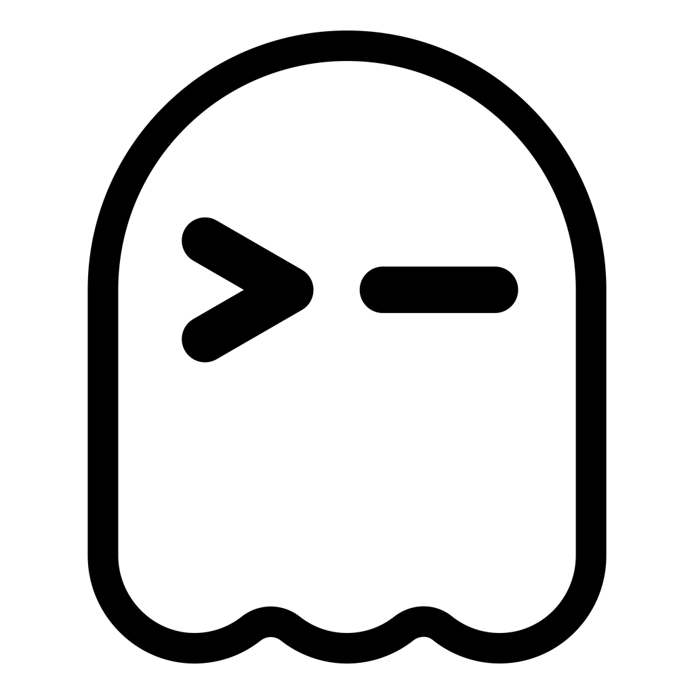
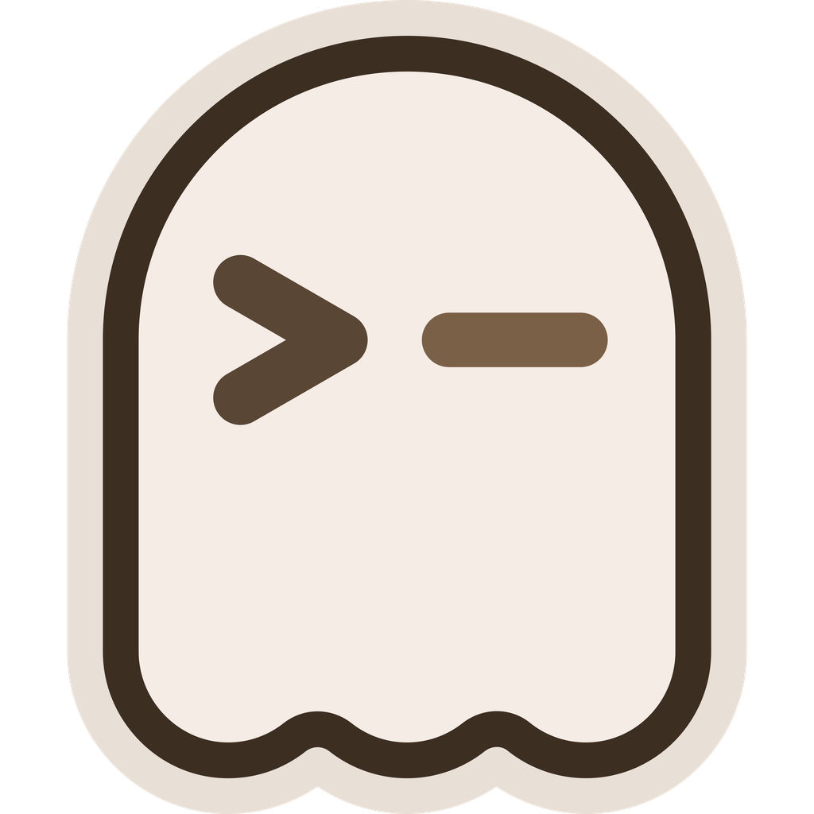
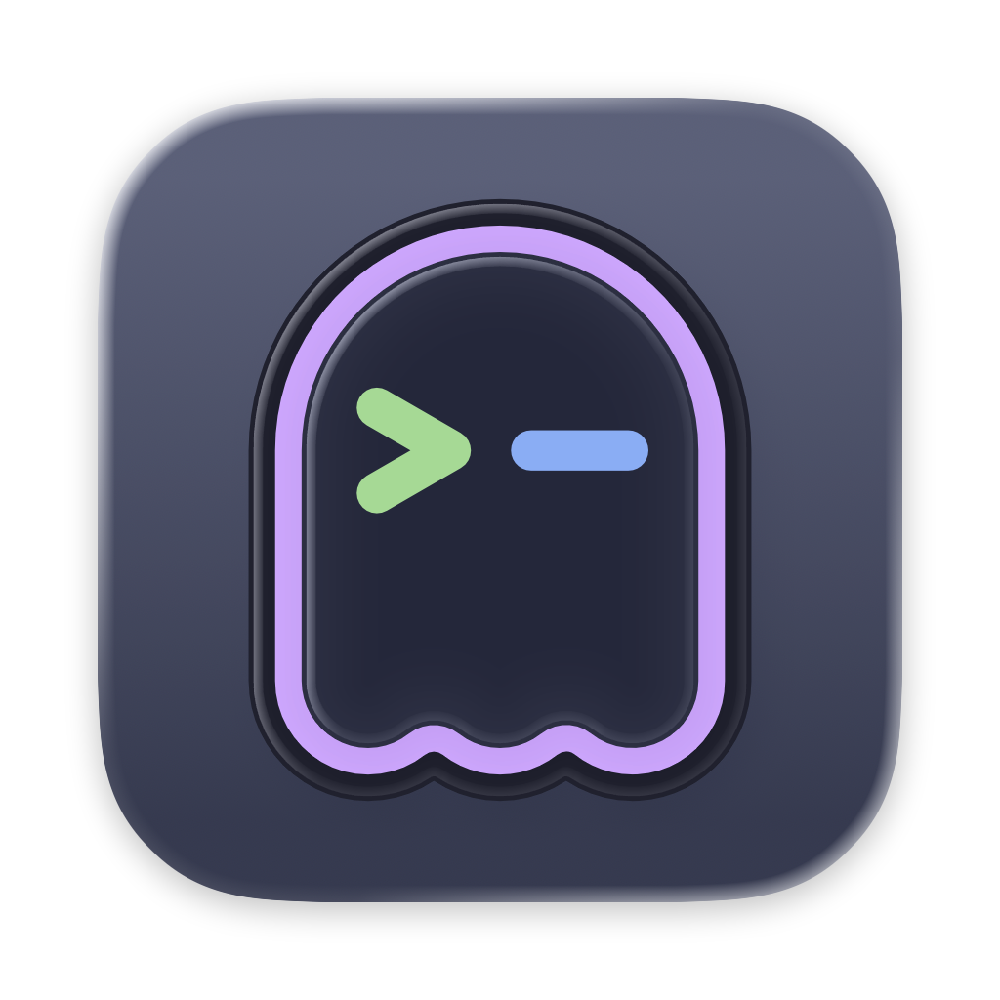
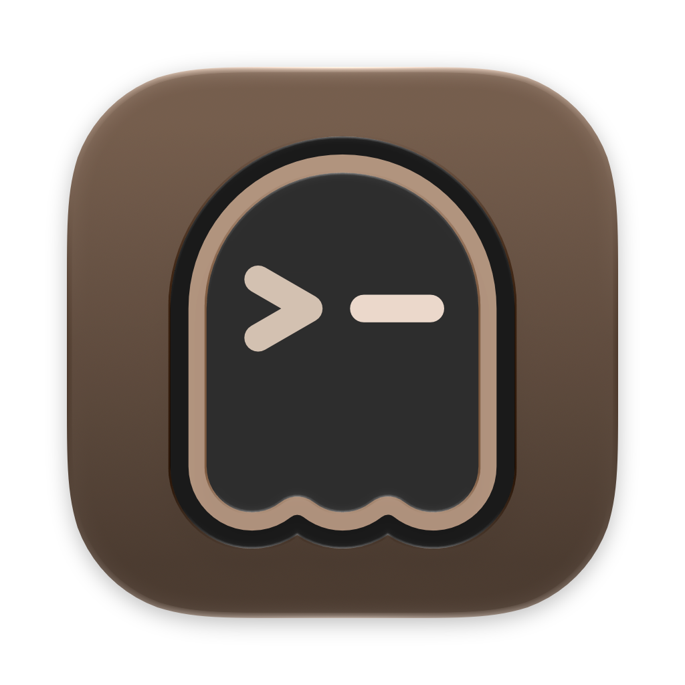
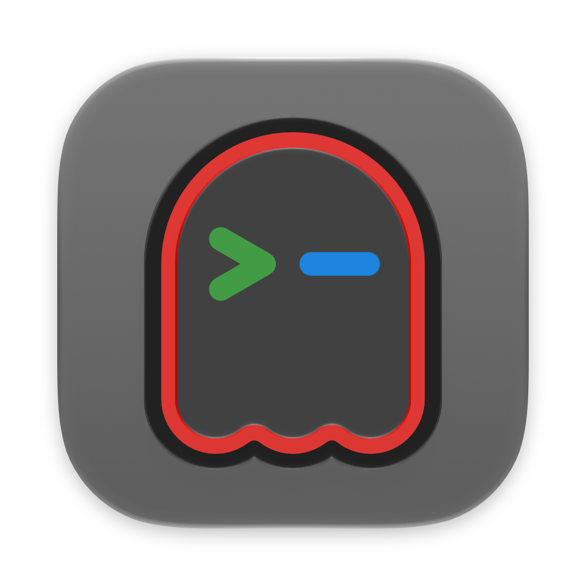

# Ghostty App Icons

<p align="center">
  <a href="./icons/tile/ghostty-tile-original-dark.icns?raw=true"></a>
  <a href="./icons/tile/ghostty-tile-original-light.icns?raw=true"></a>
</p>

Unofficial macOS app icons based on the [Ghostty logo](https://ghostty.org/ghostty-logo.svg).

## Installation

1. Download an `.icns` file and copy it to `~/.config/ghostty/icons/`.

   ```sh
   mkdir -p ~/.config/ghostty/icons
   cp ~/Downloads/ghostty-tile-graphite-dark.icns ~/.config/ghostty/icons/
   ```

2. Edit your Ghostty config file (typically `~/.config/ghostty/config.ghostty`) to select the installed icon.

   ```ini
   macos-icon = custom
   macos-custom-icon = ~/.config/ghostty/icons/ghostty-tile-graphite-dark.icns
   ```

3. Reload Ghostty’s configuration.

Ghostty 1.4 supports custom icons in the Dock, app switcher, and Finder. Finder may need a view refresh to show the new icon. See [Ghostty icon settings](https://ghostty.org/docs/config/reference#macos-custom-icon) and [Ghostty 1.4 release notes](https://ghostty.org/docs/install/release-notes/1-4-0).

### Switch icons with light and dark mode

Choose one icon for light mode and one for dark mode from [Downloads](#downloads). Copy both `.icns` files to `~/.config/ghostty/icons/`.

Make a local copy of each terminal theme you want to use. Bundled themes are in `/Applications/Ghostty.app/Contents/Resources/ghostty/themes/`. Save the copies in `~/.config/ghostty/themes/` as `Light with Icon` and `Dark with Icon`, creating the folder if needed.

Set `macos-custom-icon` in each copy, using the filenames you downloaded.

**`~/.config/ghostty/themes/Light with Icon`**

```ini
macos-custom-icon = ~/.config/ghostty/icons/ghostty-tile-original-light.icns
```

**`~/.config/ghostty/themes/Dark with Icon`**

```ini
macos-custom-icon = ~/.config/ghostty/icons/ghostty-tile-original-dark.icns
```

In `~/.config/ghostty/config.ghostty`, select the two local themes. Remove or comment out any `macos-custom-icon` line in this file so Ghostty uses the icon from each theme.

```ini
macos-icon = custom
theme = light:Light with Icon,dark:Dark with Icon
```

Reload Ghostty to apply the changes. See [Ghostty light and dark themes](https://ghostty.org/docs/features/theme#separate-light-and-dark-themes).

## Downloads

### Cutouts

<table>
  <thead>
    <tr><th scope="col">Theme</th><th scope="col" align="left">Variants</th></tr>
  </thead>
  <tbody>
    <tr>
      <th scope="row">Original</th>
      <td align="left">
        <a href="./icons/cutout/ghostty-cutout-original.icns?raw=true"></a>
      </td>
    </tr>
    <tr>
      <th scope="row">Graphite</th>
      <td align="left">
        <a href="./icons/cutout/ghostty-cutout-graphite-light.icns?raw=true"></a>
        <a href="./icons/cutout/ghostty-cutout-graphite-dark.icns?raw=true"></a>
      </td>
    </tr>
    <tr>
      <th scope="row">Black &amp; White</th>
      <td align="left">
        <a href="./icons/cutout/ghostty-cutout-white.icns?raw=true"></a>
        <a href="./icons/cutout/ghostty-cutout-black.icns?raw=true"></a>
      </td>
    </tr>
    <tr>
      <th scope="row">Catppuccin</th>
      <td align="left">
        <a href="./icons/cutout/ghostty-cutout-catppuccin-latte.icns?raw=true"></a>
        <a href="./icons/cutout/ghostty-cutout-catppuccin-frappe.icns?raw=true"></a>
        <a href="./icons/cutout/ghostty-cutout-catppuccin-macchiato.icns?raw=true"></a>
        <a href="./icons/cutout/ghostty-cutout-catppuccin-mocha.icns?raw=true"></a>
      </td>
    </tr>
    <tr>
      <th scope="row">Café</th>
      <td align="left">
        <a href="./icons/cutout/ghostty-cutout-cafe-latte.icns?raw=true"></a>
        <a href="./icons/cutout/ghostty-cutout-cafe-espresso.icns?raw=true"></a>
      </td>
    </tr>
    <tr>
      <th scope="row">Material</th>
      <td align="left">
        <a href="./icons/cutout/ghostty-cutout-material-light.icns?raw=true"></a>
        <a href="./icons/cutout/ghostty-cutout-material-dark.icns?raw=true"></a>
      </td>
    </tr>
    <tr>
      <th scope="row">Cute</th>
      <td align="left">
        <a href="./icons/cutout/ghostty-cutout-cute-by-day.icns?raw=true"></a>
        <a href="./icons/cutout/ghostty-cutout-cute-by-night.icns?raw=true"></a>
      </td>
    </tr>
  </tbody>
</table>

### Tiles

<table>
  <thead>
    <tr><th scope="col">Theme</th><th scope="col" align="left">Variants</th></tr>
  </thead>
  <tbody>
    <tr>
      <th scope="row">Original</th>
      <td align="left">
        <a href="./icons/tile/ghostty-tile-original-light.icns?raw=true"></a>
        <a href="./icons/tile/ghostty-tile-original-dark.icns?raw=true"></a>
      </td>
    </tr>
    <tr>
      <th scope="row">Graphite</th>
      <td align="left">
        <a href="./icons/tile/ghostty-tile-graphite-light.icns?raw=true"></a>
        <a href="./icons/tile/ghostty-tile-graphite-dark.icns?raw=true"></a>
      </td>
    </tr>
    <tr>
      <th scope="row">Black &amp; White</th>
      <td align="left">
        <a href="./icons/tile/ghostty-tile-white.icns?raw=true"></a>
        <a href="./icons/tile/ghostty-tile-black.icns?raw=true"></a>
      </td>
    </tr>
    <tr>
      <th scope="row">Catppuccin</th>
      <td align="left">
        <a href="./icons/tile/ghostty-tile-catppuccin-latte.icns?raw=true"></a>
        <a href="./icons/tile/ghostty-tile-catppuccin-frappe.icns?raw=true"></a>
        <a href="./icons/tile/ghostty-tile-catppuccin-macchiato.icns?raw=true"></a>
        <a href="./icons/tile/ghostty-tile-catppuccin-mocha.icns?raw=true"></a>
      </td>
    </tr>
    <tr>
      <th scope="row">Café</th>
      <td align="left">
        <a href="./icons/tile/ghostty-tile-cafe-latte.icns?raw=true"></a>
        <a href="./icons/tile/ghostty-tile-cafe-espresso.icns?raw=true"></a>
      </td>
    </tr>
    <tr>
      <th scope="row">Material</th>
      <td align="left">
        <a href="./icons/tile/ghostty-tile-material-light.icns?raw=true"></a>
        <a href="./icons/tile/ghostty-tile-material-dark.icns?raw=true"></a>
      </td>
    </tr>
    <tr>
      <th scope="row">Cute</th>
      <td align="left">
        <a href="./icons/tile/ghostty-tile-cute-by-day.icns?raw=true"></a>
        <a href="./icons/tile/ghostty-tile-cute-by-night.icns?raw=true"></a>
      </td>
    </tr>
  </tbody>
</table>
